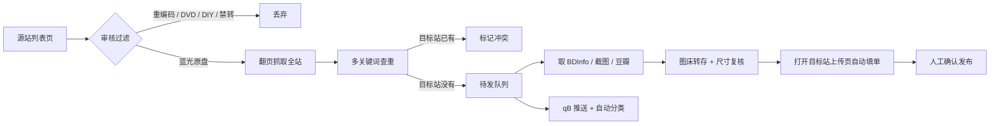

<div align="center">
  
</div>

<h1 align="center">PT 原盘转载发布与智能查重助手</h1>

<p align="center"><b>从 A 站到 B 站，蓝光原盘的一条龙搬运流水线</b><br/>
筛选、查重、排版、填单、推种，全部在一悬浮面板里完成</p>

<p align="center">
  
  
  
  
  
  
</p>

<p align="center">
  <a href="#快速开始">快速开始</a> ·
  <a href="#技术亮点">技术亮点</a> ·
  <a href="#架构">架构</a> ·
  <a href="#工作流">工作流</a> ·
  <a href="#关键约定">关键约定</a> ·
  <a href="#开发与测试">开发与测试</a>
</p>

---

## 这是什么

一个 Tampermonkey 单文件脚本（6000+ 行，无构建步骤），用来把**未处理过的蓝光原盘**从一个私有 PT 站搬到另一个 PT 站。它读源站列表、剔掉重编码/DVD/DIY/禁转、去目标站查重、把可发的排进待发队列，再从源站详情页取 BDInfo、截图、豆瓣简介，自动填好目标站上传表单。

- 支持页面：NexusPHP · UNIT3D · Gazelle · f3nix（BeyondHD）
- 目标站默认 PterClub，可在设置里换成任意已支持站点
- 单文件即装即用：Tampermonkey → 新建脚本 → 粘贴 → 保存

---

## 技术亮点

| 模块 | 做的事 |
|---|---|
| **站点适配层** | 按页面结构分派 `NexusPHP / UNIT3D / Gazelle / f3nix` 四种解析器，选择器“先精确后兜底”多级回退，站点改版只改一处 |
| **查重引擎** | IMDb → 片名 → `AKA` 原名 → 完整片名，四段关键词回退；命中后用「4K 属性 + 体积差 ≤1%」二次校验，避免同名不同片误判 |
| **熔断保护** | 目标站返回登录页或 403 立刻中止本轮并保留断点；429 阶梯退避 60 秒；查重间隔 ≥4 秒、每 10 条歇 30 秒 |
| **词库** | 按目标站分区、32 分片存储、默认 720 小时 TTL，支持导出/导入；命中的条目零网络请求直出结论 |
| **断点续跑** | 同时记录「抓到第几页」与「已查过的种子 id」，换页面 URL 不作废；只有真翻到最后一页才标记完成 |
| **截图管线** | 多描述容器合并 → 缩略图后缀还原 → 图片代理解包 → 候选地址逐个测宽取最大 → 二进制上传 → 返图尺寸复核 |
| **BDInfo 解析** | 逐行解析 `Disc Title/Disc Size/Playlist/Video/Audio/Subtitle` 重建表格；字幕语言只认 `Subtitle:` 行，杜绝裸 `ENG` 误判 |
| **填单注入** | `DataTransfer` 直接塞 `.torrent`、字段分批锁定、标题守卫（检测到人工输入立即放手） |
| **限速调度** | 每站独立令牌桶，翻页 2–3.2 秒/页、每 20 页歇 12 秒，按站点反馈动态降速 |

---

## 架构

单文件内部仍按“库”分区，靠命名前缀与注释块划分，便于定位：

```
single-file userscript
├── sites      站点识别、URL 拼装、详情页解析
├── audit      列表页审核：过滤重编码/DVD/DIY/禁转，挂工具条
├── batch      翻页抓取、断点、进度
├── dupe       查重：多关键词回退、体积校验、结果判定
├── library    词库：分片存储、TTL、导入导出
├── bdinfo     BDInfo 解析与表格重建
├── subtitle   副标题排版：片名/版本/导演/主演/语言/字幕
├── publish    转种：填单、塞种、标题守卫
├── shots      截图收集、候选探测、尺寸复核
└── imgbed     图床：SSO 登录、二进制上传、映射缓存
```

---

## 工作流



---

## 快速开始

1. 安装 [Tampermonkey](https://www.tampermonkey.net/)。
2. 打开 [`legacy/pt-bluray-assistant-v0.0.0.27.user.js`](legacy/pt-bluray-assistant-v0.0.0.27.user.js)，点 `Raw` 确认安装。
3. 刷新 PT 站页面，右上角出现「转种与调度中枢」面板。
4. 设置里填：源站 / 目标站、qBittorrent 地址与账号、qB 分类、截图上限、主演数量。
5. 点「搜索预设」锁定原盘筛选条件 → 「拉取数据」开始审核与查重。
6. 队列里点「⚡ 全套」= 转种 + 推 qB。

> 不需要 npm、不需要构建，也不需要 API Key（UNIT3D 站点可选填，填了走 API 更快）。

---

## 面板布局

```
┌─────────────────────────┬─────────────────────────┐
│ 副标题                  │ 转载站 / 发布站          │
│                         │ 运行通道 / 下载器        │
├─────────────────────────┼─────────────────────────┤
│ 简介                    │ 实时运行日志             │
├─────────────────────────┼─────────────────────────┤
│ 抓当前页   复制副标题    │ 面板设置   搜索预设      │
│ 重新生成   确认发布      │ 拉取数据   二查          │
│                         │ 断点暂停   显示全部      │
└─────────────────────────┴─────────────────────────┘
```

---

## 关键约定

1. **标题**取源站固定位置原文（详情页 `h1.torrent__name`、列表行 `a.torrent-search--list__name`），一字不改；只在为空时填一次，人工改过后不再触碰。
2. **副标题**：`中文名 | 版本 | 导演:X | 主演:A / B / C | [语言] | [字幕]`。
3. **英字**只看 BDInfo `Subtitle:` 行；**中字**看 BDInfo 语言或简介里的“中字/中文”。
4. **截图**必须拿原图：带 `.th/.md` 的地址会被还原，代理地址会解包，测不到宽度也不退回缩略图。
5. **不落任何站点密码**，图床登录仅通过浏览器单点登录完成。
6. **发布前复核**：命中冲突立即中止并说明原因，不静默上传。

---

## 开发与测试

**版本号规则**：从 `0.0.0.1` 起，每次更新 +0.0.0.1，四段式只增不减，作废的号不回收；每版新建文件，旧版永不覆盖。改版本必须同步三处：`@version`、面板标题、启动日志。

```powershell
node --check legacy\pt-bluray-assistant-v0.0.0.27.user.js
```

回归测试（Node，切片执行源码片段，不依赖浏览器）：

```
pt_cast_test        pt_title2_test      pt_label_test        pt_shot_test
pt_auth_test        pt_aka_test         pt_imgverify_test     pt_info_test
pt_decl_test        pt_pixhost_test     pt_mteam_test         pt_mteam_preset_test
pt_mteam_crawl_test pt_err_test         pt_worker_test        pt_qb_test
```

全部 `ALL PASS` 才允许交付。

---

## 目录

```
legacy/pt-bluray-assistant-v0.0.0.27.user.js   当前单文件版（安装这个）
docs/banner.png                                封面图
docs/mascot.png                                角色原图
docs/AI-CONTEXT.md                             给接手的 AI 的上下文与硬规则
docs/DEVELOPMENT.md                            开发说明（与 README 同源）
```

---

## 已知限制

- 目标站按种子文件名回填标题：用「文件名=源站标题 + 标题守卫」压制，仍建议发布前扫一眼。
- 词库中旧规则得出的“可发”结论在有效期内仍然生效，可用「二查」逐条强制刷新。
- 字段粘连的 HDDVDinfo（`Disc Size:` 与 `Playlist:` 同行）不解析，需手工替换。
- 图床若把长图压缩，脚本回退原链；此时简介内为源站原图地址。
- M-Team 列表为前端渲染，必须在页面内翻页，无法走服务端抓取。

---

## 致谢

- [Tampermonkey](https://www.tampermonkey.net/) — 运行时
- [PterClub](https://pterclub.net/) — 目标站与图床
- 大肥鱼 DeepSeek 和主任深夜激情开发出来的呢~

## 许可

仅供个人在已获授权的私有 PT 站之间搬运资源。请遵守各站规则：转种前确认无禁转、无重复。
